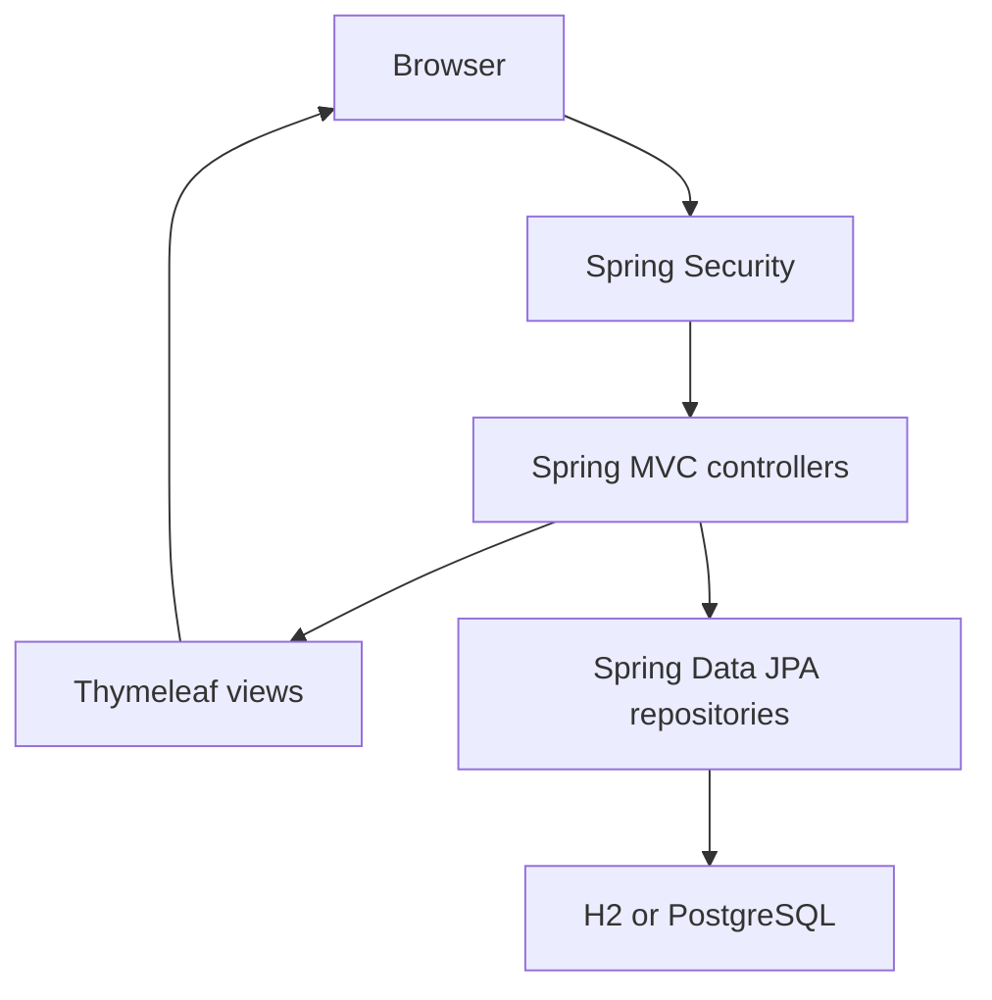

# Study Group Finder — Architecture

Study Group Finder is a Java 17 / Spring Boot 3.5.5 application. Spring MVC controllers render Thymeleaf HTML; Spring Security manages authentication and authorization; Spring Data JPA/Hibernate persists the domain entities.

## Request handling

`HomeController` redirects the root to `/groups`. `AuthController` serves registration and the login view. `StudyGroupController` handles browse/search, validated creation and joining. `AdminController` lists and suspends groups. Constructor-injected repositories provide access to `Student`, `StudyGroup` and `Membership`; [the domain model](domain-model.md) describes the tables and constraints.

| Route | Access and behavior |
|---|---|
| `GET /groups` | Public; active groups and optional exact `course` search |
| `GET /register`, `POST /register` | Public; validated registration creates a BCrypt-hashed `STUDENT` account, then redirects to login |
| `GET /login`, `POST /login` | Public; Spring Security form authentication |
| `POST /logout` | Ends the authenticated session |
| `GET /groups/new`, `POST /groups` | Authenticated; create an active group with creator supplied by the server |
| `POST /groups/{id}/join` | Authenticated; rejects suspended groups, duplicates and full groups |
| `GET /admin/groups` | ADMIN; lists all groups and their status |
| `POST /admin/groups/{id}/suspend` | ADMIN; preserves the row/memberships and sets `SUSPENDED` |
| `GET /actuator/health` | Public; health response used by Render |

CSRF protection remains enabled for form POSTs. A repository-backed `UserDetailsService` loads the account and role. `/admin/**` requires `ROLE_ADMIN`; other protected routes require authentication. A student requesting the admin page receives 403; a signed-out visitor is redirected to login. Registration always assigns `STUDENT`.

## Configuration and storage

| Environment | Database and configuration |
|---|---|
| Local default | File-backed H2, `jdbc:h2:file:./data/studygroupfinder`, schema update |
| Automated tests | In-memory H2 from test resources, schema `create-drop` |
| Production | Render PostgreSQL; `prod` profile; database connection supplied at runtime |

`application-prod.properties` reads `PORT` (fallback 8080), disables the H2 console, exposes health/probes and excludes stack traces from error responses. The Docker entrypoint derives the JDBC URL, username and password from Render's `DATABASE_URL`. Secrets stay in Render rather than Git. PostgreSQL preserves records independently of the ephemeral web container.

## Build and delivery

The Docker build stage uses `eclipse-temurin:17-jdk` and the Maven wrapper to package the JAR; the runtime stage uses `eclipse-temurin:17-jre`. Runtime configuration is injected through environment variables.

Pull requests to `main` and pushes to `main` trigger GitHub Actions. `build-test` runs Maven verification and uploads Surefire reports; `docker-build` depends on successful tests. Protect Main requires a PR and both checks, and blocks force pushes/deletion. Render waits for checks on the merged commit using `autoDeployTrigger: checksPass`, builds the image, starts the instance and checks `/actuator/health` before routing traffic to it.

The committed Blueprint creates `sgf-p466-group2-web` and `sgf-p466-group2-db`, both Free plan in Ohio, with PostgreSQL 17. See the [README](../README.md) for all environment variables, commands, live demo credentials, CI failure/recovery links and the automatic deployment demonstration.
