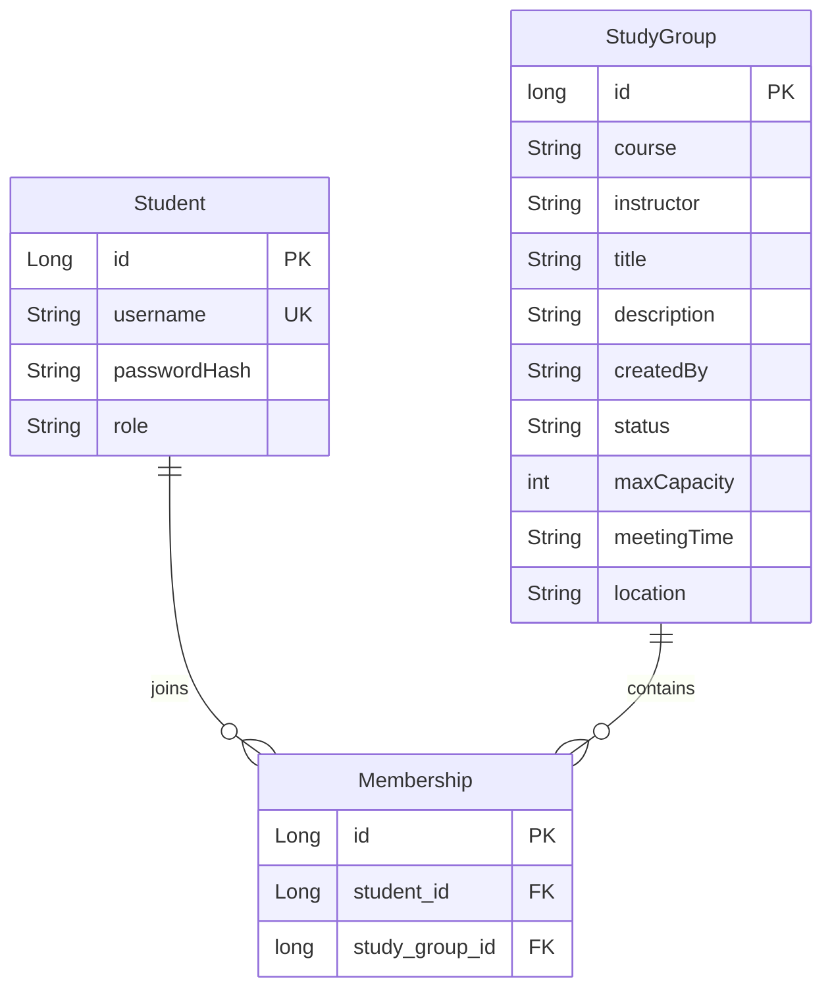

# Study Group Finder — Domain Model

Release 1.0 uses Spring Data JPA/Hibernate with three entities: `Student`, `StudyGroup` and `Membership`.

## Entities and constraints

| Entity/table | Fields and rules |
|---|---|
| `Student` / `student_account` | Identity-generated `Long id`; required unique `String username` (40 characters); required `String passwordHash` (255); `String role` initialized to `STUDENT` |
| `StudyGroup` / `study_group` | Generated `long id`; required `String course`, `instructor`, `title`; optional `String description`, `meetingTime`, `location`; server-assigned `String createdBy`; `String status` initialized to `ACTIVE`; `int maxCapacity` from 2 through 100 |
| `Membership` / `group_membership` | Identity-generated `Long id`; non-null lazy `@ManyToOne Student` through `student_id`; non-null lazy `@ManyToOne StudyGroup` through `study_group_id`; unique pair `(student_id, study_group_id)` |

Registration normalizes usernames to lowercase, checks uniqueness, hashes passwords with BCrypt and assigns the `STUDENT` role. Administrators are provisioned separately. Public registration cannot assign an administrator role.

`StudyGroup.createdBy` stores the authenticated username as text. The controller supplies it from the signed-in account, so a submitted form cannot choose another creator. Membership holds the foreign-key associations shown above.

## Group lifecycle and membership

An authenticated user creates an `ACTIVE` group. More than one group can use the same course/instructor. Creation starts with zero memberships; the creator joins through the same join operation as other users. The list displays title, course, instructor, meeting time, location and membership count/capacity. Course search matches the complete value exactly.

Joining checks that the group exists, is active, has space and has no membership for that student. The unique membership pair also enforces duplicate protection in the database. Counts are derived from membership records. The application-level capacity check can race under simultaneous requests for the last slot.

An administrator can set a group to `SUSPENDED`. The group row and existing memberships remain stored. Public browse/search exclude suspended groups, and the server rejects attempts to join them. Administrators can view both active and suspended groups. Legacy rows with null status are treated as active.

## Persistence

Local development uses file-backed H2; tests use isolated in-memory H2; Render uses managed PostgreSQL. Accounts, groups, memberships and suspension status survive a web-service restart because production storage is separate from the container.

See [architecture](architecture.md) for routes and deployment and [design decisions](design-decisions.md) for the design rationale.
